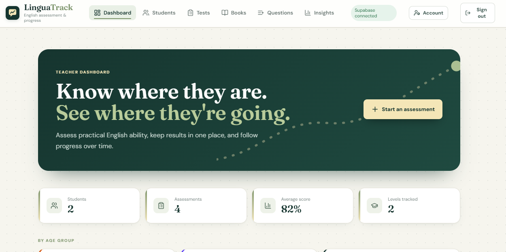
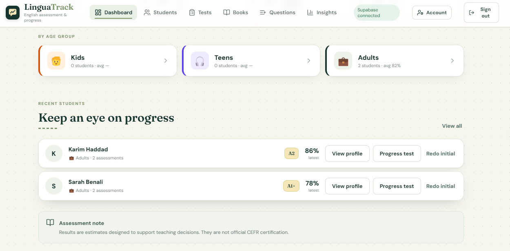
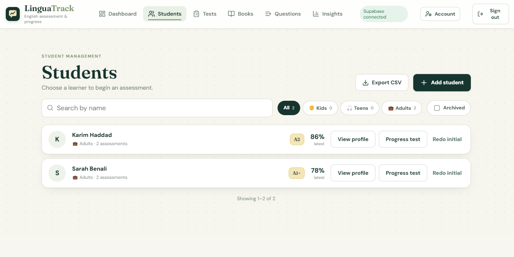
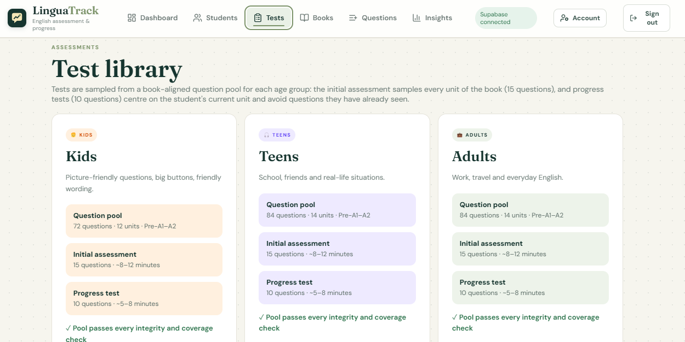
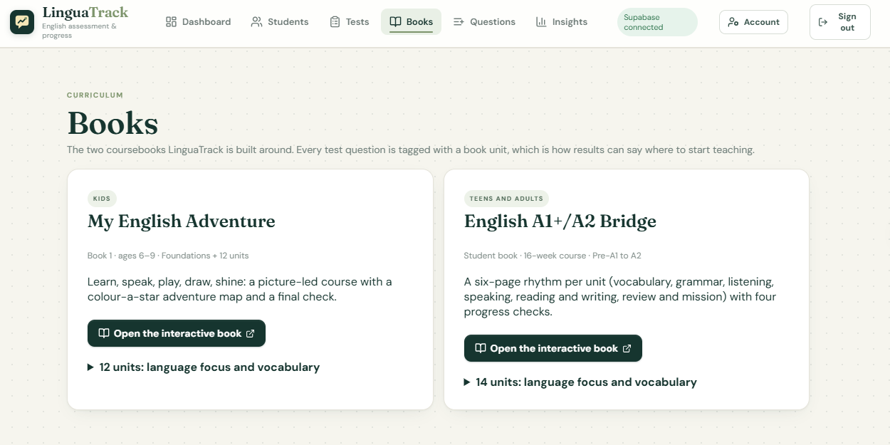
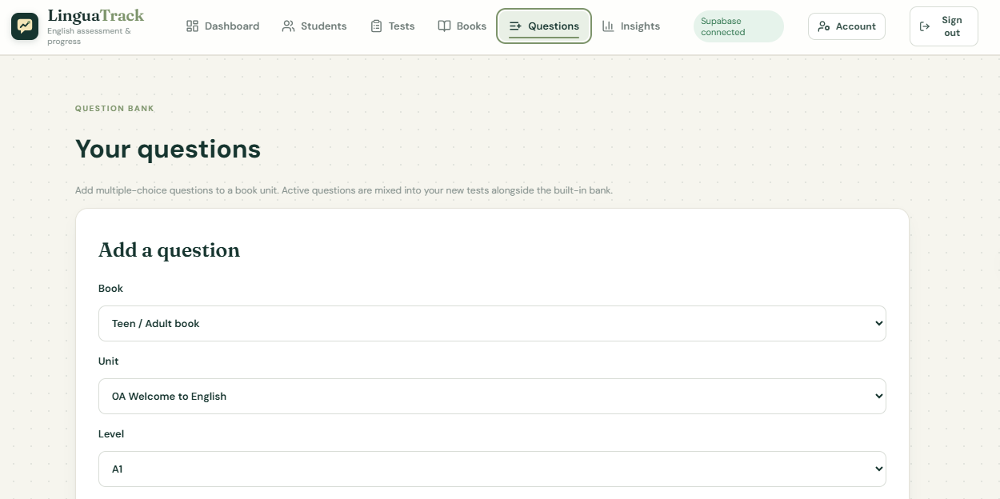
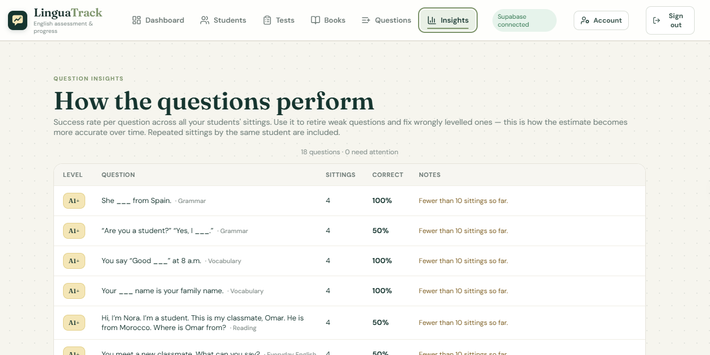
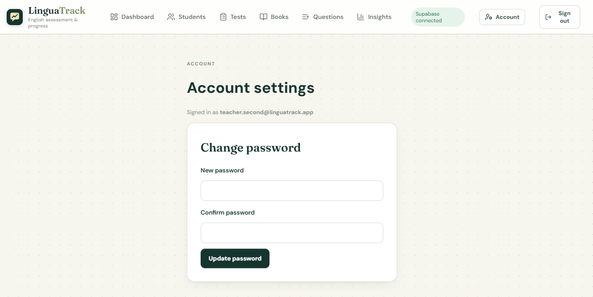
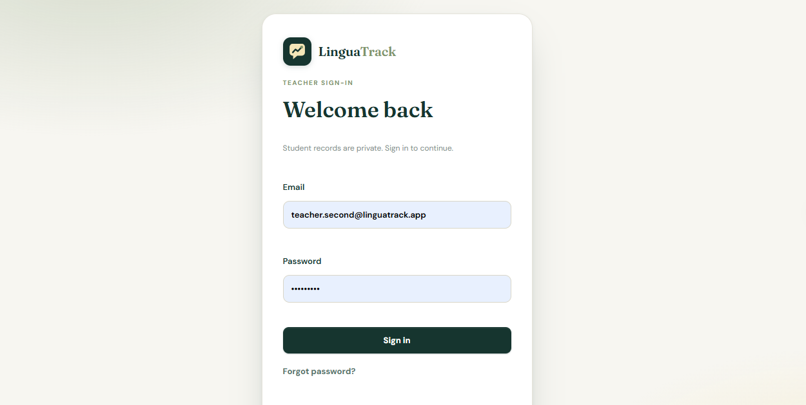

<p align="center"></p>

<p align="center"><strong>English placement tests, student profiles and coursebook progress, in one private teacher workspace.</strong></p>

<p align="center"></p>

<!-- Live demo: add the Vercel URL and the demo login here once deployed. -->

LinguaTrack helps an English teacher find where a learner should start in a coursebook, then track their progress over time. Teachers sign in, keep their own students, run a short placement or progress test, and see levels, skill scores, book-unit stars and question-level statistics. It ships with two original coursebooks (kids, and teen/adult A1+ → A2) that the tests are aligned to.

> Levels are teaching-support estimates, not official CEFR certificates.

## Features

- **Placement and progress tests**, book-aligned: the initial test samples every unit of the coursebook; progress tests avoid questions the student has already seen and centre on their current unit.
- **Three learner modes** (Child, Teen, Adult) with their own question pools and curricula.
- **Student profiles** with notes, assessment history, level-over-time chart, and 0–3 star progress per book unit.
- **Teacher-editable question bank:** add your own multiple-choice questions to a unit; they are mixed into your tests.
- **Question insights:** per-question success rates flag items that are too easy, too hard, or wrongly levelled.
- **Reports and exports:** print-ready student report (save as PDF) and a formula-safe CSV export.
- **Accounts:** email/password sign-in, password reset by email, archive/restore or fully delete a student and their data.
- **Works offline:** results that can't be saved are queued on the device and re-sent later.
- **Demo mode** with sample students when no backend is configured.

## Screenshots

<table>
  <tr>
    <td width="50%"><br /><sub><b>Recent students</b>: Recent students with level stamps, latest score and one-click progress tests</sub></td>
    <td width="50%"><br /><sub><b>Students</b>: Student list with search, age-group filters, archive view and CSV export</sub></td>
  </tr>
  <tr>
    <td width="50%"><br /><sub><b>Test library</b>: Test library: question pools, initial and progress tests per age group</sub></td>
    <td width="50%"><br /><sub><b>Books</b>: The two coursebooks the tests are aligned to, with unit lists</sub></td>
  </tr>
  <tr>
    <td width="50%"><br /><sub><b>Question bank</b>: Teacher-editable question bank: add your own questions to a book unit</sub></td>
    <td width="50%"><br /><sub><b>Insights</b>: Question insights: success rate per question, flags for weak items</sub></td>
  </tr>
  <tr>
    <td width="50%"><br /><sub><b>Account</b>: Account settings with password change</sub></td>
    <td width="50%"><br /><sub><b>Sign-in</b>: Private sign-in with password reset</sub></td>
  </tr>
</table>


## Tech stack

React 18 + Vite · Supabase (Auth, Postgres, Row Level Security) · plain CSS · Node's built-in test runner · GitHub Actions CI · Vercel.

## Design decisions

| Decision | Why |
|---|---|
| **Row Level Security on every table** (`teacher_id = auth.uid()`) | Privacy is enforced by the database, not by front-end code. A second teacher's account sees none of the first teacher's data (checked with a real Postgres). |
| **`submit_assessment` is one database function** | The assessment and all its answers are saved in a single transaction. A `client_id` makes retries idempotent, so a lost response never creates a duplicate. |
| **Offline queue with error classification** | Network failures are retried; permanent rejections are set aside for export instead of retrying forever (`src/lib/sync.js`). |
| **Scoring, placement and test-building are pure functions** | They live in `src/lib`, have no UI or database dependency, and are covered by the test suite. |
| **`question_stats` is a `security_invoker` view** | Insights respect the same per-teacher rules as everything else. |
| **Archive instead of delete** | Teachers keep results; deleting is still available for data-erasure requests, and cascades to all of a student's rows. |

## Architecture

```text
Supabase Auth (auth.users)
   └── teacher-owned Postgres tables (RLS: teacher_id = auth.uid())
         ├── students             (archived_at)
         ├── assessments          (unique per teacher_id + client_id)
         ├── assessment_answers
         ├── unit_progress        (unique per student_id + unit_id)
         └── custom_questions     (teacher-written questions)
   view  question_stats           (security_invoker, powers Insights)
   rpc   submit_assessment(jsonb) (transactional + idempotent)
```

The entire database is one re-runnable file: `supabase/migrations/20260928000000_linguatrack_schema.sql`.

## Run it locally

Node 20+ is required. Pick **one** backend.

### Option A: hosted Supabase (no Docker)

1. Create a free project at <https://supabase.com/dashboard>.
2. **SQL Editor → New query**: paste `supabase/migrations/20260928000000_linguatrack_schema.sql` and run it.
3. **Project Settings → API**: copy the Project URL, the anon/publishable key and the service-role/secret key.
4. Create the env files (`cp` on macOS/Linux, `copy` on Windows):

   ```bash
   cp .env.example .env            # VITE_SUPABASE_URL, VITE_SUPABASE_ANON_KEY
   cp .env.seed.example .env.seed  # SUPABASE_URL, SUPABASE_SERVICE_ROLE_KEY (never commit)
   ```

5. Install, seed the demo data, run:

   ```bash
   npm install
   npm run seed:supabase
   npm run dev
   ```

### Option B: fully local Supabase (Docker required)

```bash
npm install
npx supabase init     # once
npx supabase start    # applies supabase/migrations and prints the URL and keys
```

Put the printed keys in `.env` and `.env.seed`, then `npm run seed:supabase` and `npm run dev`. `npx supabase db reset` wipes and re-applies the schema.

### Demo accounts

| Account | Password |
|---|---|
| `teacher.demo@linguatrack.app` | `LinguaDemo2026!` |
| `teacher.second@linguatrack.app` | `LinguaDemo2026!` |

Each teacher has separate students, results and progress. Re-running the seed resets these two passwords. Change or delete the accounts before real use. With no Supabase variables set, the app runs as a local, clearly labelled demo (not real authentication).

## Deploy

1. Import the repo at <https://vercel.com/new> (Vite is detected).
2. Set `VITE_SUPABASE_URL` and `VITE_SUPABASE_ANON_KEY` (anon key only, never the service-role key).
3. In Supabase **Authentication → URL Configuration**, add the site URL as Site URL and Redirect URL so password-reset links work, and disable public sign-ups.

See `docs/DEPLOY_CHECKLIST.md`.

## Tests

```bash
npm test
```

Covers scoring, question pools and validation, curriculum placement, test building, progress, sync/retry rules, item analysis, CSV export and the custom question bank. CI runs tests and a production build on every push.

## Known limitations and roadmap

- Tests are multiple choice; speaking/writing rubrics are not built.
- No classes/groups view, book recommendations from results, or installable (PWA) mode yet.
- Interface is English only; end-to-end browser tests are not included.
- Deleting a custom question keeps its past statistics but not its text.

## License

Source code: MIT (see `LICENSE`). The coursebooks in `public/books/` are © Douniazed Louafi, all rights reserved (see `public/books/LICENSE.txt`).

Author: **Douniazed Louafi**
